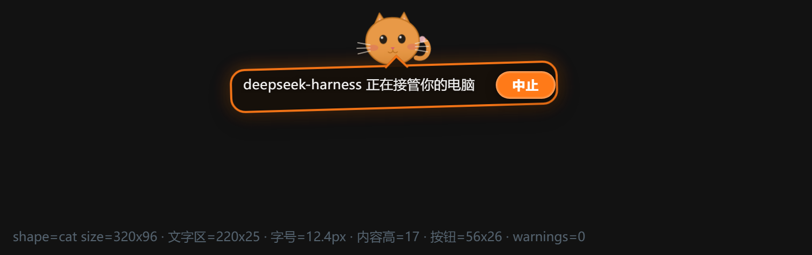
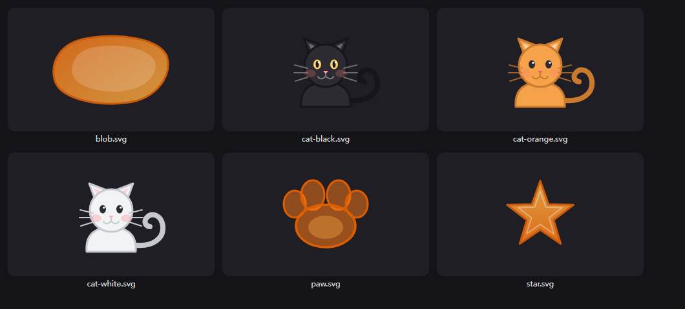

# AI-Veil（AI 接管提示器）

> 当 AI Agent 控制你的电脑时，给你一个**看得见、听得到、能中止**的信号。
> 全屏置顶边框 + 可 DIY 的形状横幅（默认是只猫）+ 桌面通知 + 提示音 + 独立中止通道。


## 0. 直接下载运行（Windows 便携版）

不想碰 Node / 构建？下载 release 里的 `AI-Veil-1.0.0-win32-x64.zip`，解压到**纯英文路径**（例如 `D:\Tools\AI-Veil\`），双击 `AI-Veil.exe` 即可。自带 Electron 运行时，无需安装任何东西。

> ⚠️ 解压路径含中文会让 Electron 崩溃（`0xc0000005`），这是 Chromium 的已知限制，不是本项目的 bug。
> 便携版未做代码签名，杀毒软件可能提示，请选择"允许/信任"。

没有 Agent 也能看效果：托盘右键 → 「演示回放（mock 11 条事件）」。

> 当 AI Agent（DeepSeek Harness、Kimi、Codex CLI、任意 MCP 客户端……）开始操控你的电脑时，
> 用**系统级视觉遮罩 + 桌面通知 + 声音提示 + 独立中止通道**告诉你："现在有人在用你的电脑"。





> 上面两张图是用项目里真实的 `banner.js` / `shapes/*.js` / `border.js` 在无头 Chromium 里渲染出来的实拍图
> （渲染脚本不在交付物内，只用于自检）。

- 视觉高度可 DIY：9 种横幅形状（含内置矢量猫咪）、5 种边框样式、4 套主题、待机/入场动画
- 视觉可关（边框关掉、横幅关掉都行），但**中止通道 / 通知 / 声音 / TTL 兜底永远在线**
- 配置全部热更新：改 `~/.ai-veil/config.toml` 或托盘设置面板，无需重启
- 数据只留本机：不联网、不上传，缩略图默认关闭

---

## 1. 功能说明

### 1.1 三层反馈

| 层 | 内容 | 可关闭 | 实现位置 |
| --- | --- | --- | --- |
| 视觉 · 边框 | 在 AI 正在感知/控制的区域绘制高亮边框（solid / dashed / dotted / double / gradient + breathe / dash / scan / pulse） | 可以（`border.visible=false` 或 `border.scope="none"`，此时**不创建边框层 DOM**） | `src/border/*` + `main.js`（窗口置顶/穿透） |
| 视觉 · 横幅 | 屏上半透明横幅，文案支持变量插值，形状可切换/自定义 | 可以（`banner.visible=false`） | `src/banner/*`、`src/shapes/*` |
| 桌面通知 | 接管开始 / 结束 / 异常 / 需人工介入四类事件发系统通知，可选截屏缩略图 | 可以（`notify.enabled=false`） | `lib/notify.js` |
| 声音 | 四类事件提示音，默认 Web Audio 实时合成（零二进制音频资源），也可指定自定义音频文件 | 可以（`sound.enabled=false` / 按事件开关） | `src/audio/synth.js` + `lib/assets.js`（自定义音频白名单） |

### 1.2 中止通道（底线能力）

三路入口，互相独立，**Agent 进程卡死也有效**：

1. 全局热键（默认 `Ctrl+Alt+Esc`，可在 `[hotkeys].cancel` 修改）
2. 横幅形状内的「中止」按钮（形状外区域鼠标穿透，只有按钮可点）
3. MCP 客户端调用 `veil_cancel` 工具 / 发 `veil/cancel` 通知

任一路径都会：**隐藏遮罩 → 落盘中止记录 → 通知适配器 → 前端清理并播放结束音 → 发系统通知**。

### 1.3 其他

- 托盘常驻：图标颜色即状态（灰=待机 / 橙=接管中 / 红=需介入或异常 / 黄=视觉全关），右键有「设置…」「演示回放」「打开日志目录」「恢复默认配置」等
- 配置热更新：`config.toml` 变化 500ms 内生效
- 配置损坏：自动备份为 `config.toml.broken-<时间戳>` 并重建默认配置，程序继续运行
- 多显示器：`border.follow_display=true` 时遮罩跟随事件区域所在屏
- TTL 兜底：`rules.ttl_ms` 内没有新事件（`heartbeat` 可续期）→ 自动判定会话结束并触发结束反馈

---

## 2. 目录结构

```
ai-veil/
├── main.js                           # 主进程：遮罩窗口/托盘/全局热键/22 个 IPC 命令/定时器/适配器生命周期
├── preload.js                        # 隔离世界桥：实现 __TAURI__ 兼容层 + __VEIL__ 原生 API
├── package.json                      # Electron 清单（electron + electron-builder，无运行时依赖）
├── lib/
│   ├── config.js                     # 配置结构、默认值（= config.sample.toml）、校验归一化、原子读写
│   ├── toml.js                       # 最小 TOML 解析/序列化（零依赖，支持内联表与数组）
│   ├── event-bus.js                  # 统一事件、去重/乱序容错、优先级解析、TTL、state 组装
│   ├── assets.js                     # 素材白名单、SVG 校验、导入、预设导入导出、自定义音频
│   ├── notify.js                     # 系统通知 + 可选截屏缩略图（desktopCapturer）
│   ├── log.js                        # 文件日志（~/.ai-veil/logs/ai-veil.log）
│   ├── png.js                        # 最小 PNG 编码器（零依赖）
│   ├── tray-icons.js                 # 运行时绘制五色托盘图标
│   └── adapters/
│       ├── index.js                  # 适配器注册表（mock / file / mcp_stdio / cli）
│       ├── common.js                 # JSONL 解析、中止留痕
│       ├── mcp-stdio.js              # 自带 MCP stdio 服务（veil_emit / veil_cancel）
│       ├── cli-wrapper.js            # 包装任意 Agent CLI 子进程
│       ├── file-inbox.js             # 监听 ~/.ai-veil/events.jsonl
│       └── mock.js                   # 回放 examples/mock-events.jsonl
├── assets/icons/                     # 应用与托盘图标（由 scripts/gen_icons.py 生成）
├── vendor/electron/                  # Electron 运行时（junction → ASCII 真实目录，见 §3.7）
├── .runtime/user-data/               # Electron 的 userData（缓存/LocalStorage），不进仓库
├── evidence/                         # 本地取证截图（不进仓库）
├── release/                          # 打好的便携包 zip（走 GitHub Release，不进仓库）
├── tools/                            # 开发期一次性脚本（不进仓库）
├── dsh-plugin/                       # DeepSeek Harness 侧：MCP 桥（已安装进 DSH profile）
│   ├── package.json                  # bundle 清单（dsh.bundle.patch）
│   ├── cordis.patch.yml              # Loader patch：stdio → bridge.mjs
│   ├── bridge.mjs                    # MCP stdio 服务：veil_emit / veil_cancel → 事件文件
│   ├── demo/emit-demo.mjs            # 一键演示：往事件文件灌一整段接管流程
│   ├── locale/{zh,en}.json           # 插件面板里的中英文标题/说明
│   ├── docs/DETAIL.md                # 插件详情页
│   └── icon.svg                      # 插件图标
├── src/                              # 前端（原生 HTML/CSS/ES Module，无框架、无构建步骤）
│   ├── overlay.html / overlay.css / overlay.js
│   ├── settings.html / settings.css / settings.js
│   ├── themes/{orange,cyan,mono,contrast}.css
│   ├── border/{border.js,styles.css}
│   ├── banner/{banner.js,layout.js,animation.js}
│   ├── shapes/{registry,rect,pill,speech-bubble,cat,paw,blob,star,custom-svg,image,sanitize}.js
│   ├── assets/builtin/{cat-orange,cat-black,cat-white,paw,blob,star}.svg
│   └── audio/synth.js
├── schema/config.schema.json         # 配置 JSON Schema（编辑器补全 + 设置面板校验提示）
├── examples/{config.sample.toml,mock-events.jsonl}
├── scripts/gen_icons.py              # 图标生成（Pillow，可重复执行）
├── scripts/selfcheck.mjs             # 55 项纯 Node 自检（不需要 Electron）
├── scripts/veil-lite.ps1             # 无构建回退渲染器（PowerShell，见 §3.6）
├── scripts/lite-demo.ps1             # 回退渲染器的一键演示 + 四张状态截图
├── scripts/capture-screen.ps1        # 截全屏（含置顶分层窗口，BitBlt+CAPTUREBLT）
├── scripts/launch.js                 # `npm start` 的启动器：选运行时/清环境变量/后台拉起
├── scripts/start-ai-veil.cmd         # 双击启动（内部调用 launch.js）
├── README.md
└── ASSUMPTIONS.md
```

> 前端 `src/` 与上一版 **逐字节相同**：换栈只换了"谁来托管这些页面"。
> 兼容性由 `preload.js` 提供的 `window.__TAURI__` 兼容层兜住（`core.invoke` / `core.convertFileSrc` / `event.listen`），
> 于是 overlay.js、settings.js、9 个形状模块、4 个主题一行都不用改。

---

## 3. 构建与运行

### 3.1 前置

| 平台 | 需要 |
| --- | --- |
| 全部 | Node.js ≥ 18（推荐 20/22 LTS）、npm |
| Windows | 无额外依赖（Electron 自带 Chromium，不依赖 WebView2） |
| macOS | 无额外依赖；截屏缩略图需在「系统设置 → 隐私与安全性 → 屏幕录制」授权 |
| Linux | X11 会话；`libgtk-3`、`libnss3`、`libasound2` 等 Electron 常规运行库 |

**不需要 Rust / cargo / Tauri CLI**，也不需要任何全局构建工具：

```bash
npm install          # 只装 electron 与 electron-builder（devDependencies）
```

### 3.2 开发运行

```bash
npm start                        # 消费 ~/.ai-veil/events.jsonl（默认）
npm start -- --adapter mock      # 回放 11 条样例事件（最快的验收路径）
npm start -- --adapter mcp_stdio # 当 MCP server 用（宿主把它当子进程拉起）
npm start -- --adapter cli -- node your-agent.js   # 包装任意 CLI
```

不想敲命令就双击 `scripts/start-ai-veil.cmd`。

`npm start` 实际调用 `scripts/launch.js`，它按顺序找运行时、清掉坑人的环境变量、加上 `--no-sandbox --disable-gpu`、然后**后台拉起**（命令立即返回，托盘是唯一入口）：

| 查找顺序 | 路径 |
| --- | --- |
| 1 | `$ELECTRON_OVERRIDE_DIST_PATH/electron.exe` |
| 2 | `~/.ai-veil/electron-dist/electron.exe` ← **推荐**：把 Electron 运行时缓存到这里 |
| 3 | `<项目>/node_modules/electron/dist/electron.exe` |

只有**物理位于纯 ASCII 路径**的运行时才会被采用（见下面第 4 个坑）。想把运行时放这里：

```powershell
# 一次性：把解压好的 Electron 放到用户目录（ASCII 路径，不会被 git/zip 带走）
robocopy C:\electron44 "$env:USERPROFILE\.ai-veil\electron-dist" /E
```

> **四个真实踩过的坑**（写下来省你半小时，全部在本机复现过）：
> 1. 启动后瞬间退出且日志为空 → 检查环境变量里有没有 `ELECTRON_RUN_AS_NODE`。Electron 对这个变量是**"存在即生效"**（空串也算），一旦存在就退化成纯 Node，`require("electron").app` 直接是 `undefined`。`launch.js` 已自动剔除。
> 2. 日志里只有 `crashpad_client_win.cc: not connected`、`app.on("ready")` 永不触发 → Chromium 子进程被安全软件（如火绒 HIPS）或受限完整性级别拦住了。默认已带 `--no-sandbox --disable-gpu`；要恢复严格设置就 `set AI_VEIL_ELECTRON_FLAGS=`。
> 3. **Electron 33 在本机必崩**（`0xc0000005`，`ready` 之前就挂），换成 **Electron 44** 立刻正常。`package.json` 已锁 `^44.11.5`，与本机 DSH 自带的版本一致，别降级。
> 4. **`electron.exe` 不能放在含中文的路径下**（同样 `0xc0000005`，junction/软链也会被解析回真实路径）。这就是为什么 `launch.js` 优先选 `~/.ai-veil/electron-dist` 这类 ASCII 路径。

### 3.3 打包

```bash
npm run dist        # electron-builder：Win 出 nsis/portable，macOS 出 dmg，Linux 出 AppImage
npm run pack        # 只出免安装目录，便于本机验证
```

### 3.4 首次启动会发生什么

1. 创建 `~/.ai-veil/`，写入 `config.toml`（内容 = `examples/config.sample.toml`）
2. 把内置素材播种到 `~/.ai-veil/assets/builtin/`（已存在则跳过，绝不覆盖你的文件）
3. 托盘出现灰色圆点图标，遮罩窗口创建但保持隐藏
4. 日志写入 `~/.ai-veil/logs/ai-veil.log`
5. 图片/图标如需重新生成：`python scripts/gen_icons.py`

### 3.5 不需要 Agent 也能看效果

- 托盘右键 → **演示回放（mock）**：按时间轴回放 `examples/mock-events.jsonl` 的 11 条事件（含 need_human 变红脉冲、猫形横幅、error、session.end）
- 命令行：`npm start -- --adapter mock`（或已打包的 `AI-Veil --adapter mock`）
- 环境变量：`AI_VEIL_MOCK_SPEED=2` 加速、`AI_VEIL_MOCK_LOOP=1` 循环、`AI_VEIL_MOCK_FILE=<路径>` 换样例

### 3.6 没有 Electron 时的回退渲染器（PowerShell）

目标机器装不上 Electron（无网络 / 无 npm / 受限环境）时，用这个**零构建**的渲染器也能看到完整提醒：

```powershell
npm run lite            # 启动遮罩（托盘右键 → Exit AI-Veil 退出）
npm run lite:demo       # 启动 + 演示「接管→动作→需要介入→结束」四段，并把截图存到 %TEMP%\ai-veil-demo
```

它消费**同一个** `~/.ai-veil/events.jsonl`，所以和正式版可以随时互换（同一时间只跑一个）：

| 能力 | 回退渲染器 | Electron 正式版 |
| --- | --- | --- |
| 全屏置顶边框（四色状态） | ✅ 橙 / 红（need_human 常亮呼吸）/ 暗红 | ✅ 5 种线型 + 4 种动画 + 渐变 |
| 顶部横幅 + 中文文案 | ✅ | ✅ |
| 中止按钮（鼠标穿透、只这一块可点） | ✅ | ✅ |
| 托盘图标 + 声音 + 桌面通知 | ✅ | ✅ |
| TTL 30s 兜底 / 事件即消失 | ✅ | ✅（可配 `rules.ttl_ms`） |
| 9 种形状（猫咪/气泡/爪印…） | ❌ 只有矩形 | ✅ |
| 4 套主题 / 区域边框 / 配置热更新 / 设置面板 | ❌ | ✅ |

实现细节（踩过的坑，值得记下来）：

- **Windows PowerShell 5.1 按 GBK 读无 BOM 的 UTF-8 脚本**，中文会乱、语法会被撑坏 → 这两个 `.ps1` 都带 UTF-8 BOM，改它们时别把 BOM 删了
- 5.1 没有 `System.Private.CoreLib`，不能用 C# 派生 `Form` 改 `CreateParams` → 改用 `GetWindowLong/SetWindowLong` 加 `WS_EX_TRANSPARENT | WS_EX_TOOLWINDOW | WS_EX_TOPMOST`
- `Graphics.CopyFromScreen` 的 6 参重载拒绝 `SRCCOPY|CAPTUREBLT`（枚举校验），截不到置顶分层窗口 → `capture-screen.ps1` 直接 P/Invoke `BitBlt` + `0x40CC0020`

### 3.7 磁盘占用与 Electron 运行时放置

本项目刻意把**所有东西都放在项目目录里**，不往系统盘（C:）写大文件：

| 内容 | 位置 | 是否进仓库 |
| --- | --- | --- |
| 源码、配置样例、文档 | 项目根目录 | ✅ |
| 依赖（electron 包） | `node_modules/` | ❌ |
| Electron 运行时本体 | `vendor/electron/` | ❌ |
| Electron userData（缓存/LocalStorage） | `.runtime/user-data/`（`main.js` 里 `app.setPath` 指定） | ❌ |
| 打好的便携包 | `release/` | ❌（发布到 GitHub Release） |
| 本地运行数据（配置/日志/事件） | `~/.ai-veil/`（几百 KB，与 DSH 桥共用） | — |

**关键限制**：`electron.exe` 必须位于**纯 ASCII 真实路径**，否则启动即 `0xc0000005`。因此项目在中文路径下时，`vendor/electron` 是指向 ASCII 目录的 junction：

```powershell
# 一次性准备（把运行时放到 E: 根的纯英文目录，再挂进项目）
robocopy <解压好的 electron> E:\AI-Veil-runtime\electron-dist /E
cmd /c mklink /J "E:\...\ai-veil\vendor\electron" "E:\AI-Veil-runtime\electron-dist"
```

`scripts/launch.js` 会用 `fs.realpathSync` 校验真实路径的 ASCII 性，自动跳过中文路径下的运行时。

---

## 4. 权限授予步骤

### 4.1 macOS

| 权限 | 何时需要 | 如何授予 |
| --- | --- | --- |
| 通知 | 发桌面通知 | 首次通知时系统弹窗点「允许」；若误点拒绝：`系统设置 → 通知 → AI-Veil → 允许通知` |
| 屏幕录制 | 仅当 `notify.thumbnail=true` 需要截屏 | `系统设置 → 隐私与安全性 → 屏幕录制` 勾选 AI-Veil（或启动它的终端），然后**重启应用** |
| 辅助功能 | 本程序不需要（不注入、不模拟输入） | — |
| 输入监控 | 本程序不需要（全局热键走 Carbon `RegisterEventHotKey`） | — |

> 说明：macOS 上遮罩窗口使用「始终置顶 + 全空间可见 + 不主动 set_focus」来避免抢占焦点，
> 而不是私有 NSPanel 层级（原因与验证方法见 `ASSUMPTIONS.md`）。

### 4.2 Windows

- 无需额外系统权限。首次运行可能有 SmartScreen 提示（未签名），选「更多信息 → 仍要运行」。
- 截屏缩略图走系统自带的 `System.Drawing`（PowerShell），无需额外授权。
- 若通知被系统「专注助手/勿扰」拦截：`设置 → 系统 → 通知` 中允许 AI-Veil。

### 4.3 Linux（X11）

- 需要能访问 `DISPLAY`；通知需要 `libnotify` / 桌面通知守护进程（GNOME、KDE、Dunst 均可）
- 图片截屏需要 `gnome-screenshot` / `scrot` / ImageMagick `import` 三者之一
- **Wayland 限制**：见第 9 节

---

## 5. 配置项全表

配置文件：`~/.ai-veil/config.toml`（TOML）。键名与默认值以 `examples/config.sample.toml` 为准。
`JSON Schema`：`schema/config.schema.json`（可用于编辑器补全与校验提示）。

> 数值型配置越界会被**钳制**并在日志/设置面板给出中文告警；枚举型非法值会回退默认值。程序永不因配置问题崩溃。

### 5.1 `[meta]`

| 键 | 类型 | 默认值 | 说明 |
| --- | --- | --- | --- |
| `version` | int | `1` | 配置版本，预留迁移用 |
| `theme` | string | `"orange"` | 主题：`orange` 警示橙 / `cyan` 赛博青 / `mono` 极简灰 / `contrast` 高对比黑白 |

### 5.2 `[border]`（范围边框）

| 键 | 类型 | 默认值 | 说明 |
| --- | --- | --- | --- |
| `visible` | bool | `true` | `false` = 完全不出现边框（**不创建边框层**，不是隐藏） |
| `scope` | string | `"fullscreen"` | `fullscreen` 整屏 / `region` 事件区域 / `window` 窗口区域 / `none` 关闭 |
| `width` | float | `4` | 描边宽度 px（1–32） |
| `radius` | float | `12` | 圆角 px（0–128） |
| `style` | string | `"solid"` | `solid` / `dashed` / `dotted` / `double` / `gradient` |
| `color` | string | `"#FF7A18"` | 描边主色 |
| `color_end` | string | `"#FFB347"` | 渐变终点色（`style=gradient` 时生效） |
| `glow` | string | `"0 0 24px rgba(255,122,24,.45)"` | 外发光 CSS `box-shadow` 值 |
| `animation` | string | `"breathe"` | `none` / `breathe` / `dash` / `scan` / `pulse`；`none` 时不注册任何动画 |
| `animation_duration` | float | `2.0` | 动画周期（秒，0.1–10） |
| `opacity` | float | `1.0` | 边框整体不透明度（0–1） |
| `inset` | float | `0` | 向内收缩 px（避免压住系统 UI） |
| `follow_display` | bool | `true` | 是否让遮罩跟随事件所在显示器 |

### 5.3 `[border.per_event]`（按事件覆盖，只写差异项）

| 键 | 类型 | 默认值 | 说明 |
| --- | --- | --- | --- |
| `need_human` | table | `{ color="#FF3B30", animation="pulse", width=6 }` | 需人工介入：变红 + 脉冲 |
| `error` | table | `{ color="#FF3B30", animation="scan" }` | 异常：变红 + 扫描 |
| `heartbeat` | table | `{ visible=false }` | 心跳：默认不画边框（心跳只续期 TTL） |

每个覆盖表可用的字段（全部可选）：`visible`、`scope`、`width`、`radius`、`style`、`color`、`color_end`、`glow`、`animation`、`animation_duration`、`opacity`、`inset`。
也支持其它合法事件名（`session.start`、`action.before`、`action.after`、`session.end`）。

### 5.4 `[banner]`（横幅与形状）

| 键 | 类型 | 默认值 | 说明 |
| --- | --- | --- | --- |
| `visible` | bool | `true` | 是否渲染横幅 |
| `shape` | string | `"cat"` | `rect`/`pill`/`speech_bubble`/`cat`/`paw`/`blob`/`star`/`custom_svg`/`image` |
| `variant` | string | `"orange"` | 猫咪变体：`orange` 橘猫 / `black` 黑猫 / `white` 白猫 |
| `anchor` | string | `"top-center"` | `top-center`/`top-left`/`top-right`/`bottom-center`/`custom` |
| `offset.x` | float | `0` | 锚点偏移（`anchor="custom"` 时是绝对坐标） |
| `offset.y` | float | `24` | 同上 |
| `size.w` | float | `320` | 形状宽 px（120–1600） |
| `size.h` | float | `96` | 形状高 px（40–800） |
| `scale` | float | `1.0` | 整体缩放（0.2–5） |
| `rotation` | float | `0` | 旋转角度（-180–180） |
| `opacity` | float | `0.95` | 横幅不透明度 |
| `blur` | float | `20` | 背景模糊强度（仅 rect/pill/speech_bubble/blob 支持） |
| `padding.x` | float | `18` | 文字与形状边缘的最小内边距 |
| `padding.y` | float | `12` | 同上 |
| `text_color` | string | `"#FFFFFF"` | 文字颜色 |
| `align` | string | `"center"` | `left`/`center`/`right` |
| `max_lines` | int | `2` | 最大行数（1–6，`overflow=ellipsis` 时生效） |
| `overflow` | string | `"ellipsis"` | `ellipsis` 省略号 / `wrap` 换行 / `shrink` 自动缩字号 |

### 5.5 `[banner.font]`

| 键 | 类型 | 默认值 | 说明 |
| --- | --- | --- | --- |
| `family` | string | `"system"` | `system` 用系统字体栈，也可填任意字体名（如 `"PingFang SC"`） |
| `size` | float | `15` | 字号 px（8–48） |
| `weight` | int | `500` | 字重（100–900） |
| `letter_spacing` | float | `0.3` | 字间距 px（-5–20） |

### 5.6 `[banner.custom]`（自定义素材）

| 键 | 类型 | 默认值 | 说明 |
| --- | --- | --- | --- |
| `svg_path` | string | `"~/Pictures/mascot.svg"` | `shape=custom_svg` 用 SVG；`shape=image` 用图片（png/jpg/webp/gif） |
| `image_fit` | string | `"contain"` | `contain`/`cover`/`fill`（等价 CSS `object-fit`） |
| `tint` | string | `"#FF7A18"` | 单色着色（仅 SVG），同时作用于猫咪形状的气泡描边/光晕 |

> 默认值是需求给定的样例路径。该文件通常不存在，所以直接选 `custom_svg` 会降级为圆角矩形并提示。
> 想立刻可用：托盘 → 设置 → 素材 → 「使用内置素材」，或把文件放进 `~/.ai-veil/assets/`。

### 5.7 `[banner.animation]`

| 键 | 类型 | 默认值 | 说明 |
| --- | --- | --- | --- |
| `idle` | string 或 string[] | `"blink"` | 待机动画，可独立叠加：`blink` 眨眼 / `wag` 摆尾 / `float` 浮动 / `wiggle` 摇头。数组写法如 `["blink","wag"]`，`"none"` 关闭 |
| `enter` | string | `"pop"` | 入场：`none`/`fade`/`slide`/`pop` |
| `duration` | float | `0.35` | 入场时长（秒，0.05–5） |

### 5.8 `[text]`（文案模板）

可用变量：`{agent}` `{action}` `{target}` `{duration}` `{time}`

| 键 | 类型 | 默认值 | 说明 |
| --- | --- | --- | --- |
| `start` | string | `"{agent} 正在接管你的电脑"` | `session.start` 文案 |
| `running` | string | `"{agent} 正在操控 · {action}"` | `action.before/after` 文案 |
| `waiting` | string | `"需要你介入 · {action}"` | `need_human` 文案 |
| `end` | string | `"操控已结束 · 共 {duration}"` | `session.end` / TTL 超时文案 |
| `error` | string | `"操控异常中断 · {action}"` | `error` 文案 |
| `cancel_button` | string | `"中止"` | 中止按钮文案 |

### 5.9 `[sound]`

| 键 | 类型 | 默认值 | 说明 |
| --- | --- | --- | --- |
| `enabled` | bool | `true` | 声音总开关（`false` 时完全静默，不创建 AudioContext） |
| `volume` | float | `0.6` | 音量（0–1） |
| `throttle_ms` | int | `800` | 同类声音最小间隔（0–10000） |
| `custom_path` | string | `""` | 自定义音频路径；留空则用 Web Audio 合成 |

### 5.10 `[sound.synth]`（合成参数）

| 键 | 类型 | 默认值 | 说明 |
| --- | --- | --- | --- |
| `start_wave` | string | `"sine"` | 开始音波形：`sine`/`square`/`sawtooth`/`triangle` |
| `start_freq` | float | `660` | 开始音频率 Hz（100–4000） |
| `start_dur` | float | `0.12` | 开始音时长秒（0.01–2） |
| `end_wave` | string | `"sine"` | 结束音波形 |
| `end_freq` | float | `440` | 结束音频率 |
| `end_dur` | float | `0.18` | 结束音时长 |
| `alert_wave` | string | `"square"` | 需介入/异常警报波形 |
| `alert_freq` | float | `880` | 警报频率 |
| `alert_dur` | float | `0.25` | 警报时长 |

### 5.11 `[sound.events]`（按事件开关）

| 键 | 类型 | 默认值 | 说明 |
| --- | --- | --- | --- |
| `session_start` | bool | `true` | 接管开始是否响 |
| `session_end` | bool | `true` | 接管结束是否响 |
| `need_human` | bool | `true` | 需介入是否响 |
| `error` | bool | `true` | 异常是否响 |
| `action` | bool | `false` | 动作级事件是否响（默认静音，避免噪音） |

### 5.12 `[notify]`

| 键 | 类型 | 默认值 | 说明 |
| --- | --- | --- | --- |
| `enabled` | bool | `true` | 通知总开关 |
| `duration_sec` | int | `5` | 期望停留秒数（1–60，实际由系统通知中心决定） |
| `thumbnail` | bool | `false` | 是否附带截屏缩略图（隐私优先，默认关闭） |
| `silent` | bool | `false` | 静默模式（不额外播放程序内提示音） |

### 5.13 `[rules]`

| 键 | 类型 | 默认值 | 说明 |
| --- | --- | --- | --- |
| `ttl_ms` | int | `30000` | TTL 超时自动判定会话结束（500–600000） |
| `min_takeover_ms` | int | `600` | 最小接管时长：短于它的会话不发送开始/结束的声音与通知（防刷屏），视觉不受影响 |
| `ignore_events` | string[] | `["heartbeat"]` | 完全忽略的事件（`heartbeat` 在列表里时只续期 TTL、不刷新视觉） |
| `dnd_start` | string | `""` | 免打扰开始 `HH:MM`，空表示不启用 |
| `dnd_end` | string | `""` | 免打扰结束 `HH:MM`（支持跨午夜，如 23:00–08:00） |
| `process_whitelist` | string[] | `[]` | 进程白名单（仅保留字段；当前适配器均由用户显式指定，不自动扫描进程） |
| `process_blacklist` | string[] | `[]` | 进程黑名单（同上） |

### 5.14 `[hotkeys]`

| 键 | 类型 | 默认值 | 说明 |
| --- | --- | --- | --- |
| `cancel` | string | `"Ctrl+Alt+Esc"` | 中止热键（**不可关闭**，解析失败自动回退默认值） |
| `toggle_visible` | string | `"Ctrl+Alt+V"` | 临时隐藏/恢复视觉（中止通道仍然有效） |
| `next_theme` | string | `"Ctrl+Alt+T"` | 循环切换主题 |

格式：`修饰键+键名`，修饰键支持 `Ctrl`/`Alt`/`Shift`/`Cmd`(`Super`/`Win`)，键名支持 `Esc`、`A`–`Z`、`0`–`9`、`F1`–`F24`、`Space`、`Tab`、方向键等。

### 5.15 `[assets]`（素材管线）

| 键 | 类型 | 默认值 | 说明 |
| --- | --- | --- | --- |
| `dirs` | string[] | `["~/.ai-veil/assets/"]` | 素材目录白名单（可追加任意目录；越界路径一律拒绝加载） |
| `max_bytes` | int | `524288` | 单个素材大小上限（1024–5242880） |
| `max_px` | int | `4096` | 素材边长上限（16–16384） |
| `sanitize_svg` | bool | `true` | 是否对 SVG 做净化（该开关无法真正关闭安全剥离，见 §7.2） |

### 5.16 `[privacy]`

| 键 | 类型 | 默认值 | 说明 |
| --- | --- | --- | --- |
| `upload_enabled` | bool | `false` | 是否允许上传（**强制为 false**，即使写 true 也会被关闭并告警） |
| `log_dir` | string | `"~/.ai-veil/logs"` | 日志与缩略图落盘目录 |

---

## 6. 形状清单与自定义形状制作指南

### 6.1 内置形状（9 种）

| `shape` | 说明 | 文字安全区 |
| --- | --- | --- |
| `rect` | 圆角矩形 + 顶部高光 | 内缩 `padding` |
| `pill` | 全圆角胶囊 | 内缩 `padding` |
| `speech_bubble` | 气泡 + 下方尖角 | 扣掉尖角区域 |
| `cat` | **内置 inline SVG 猫咪**（耳朵/脸/眼睛/胡须/尾巴），文字排在猫脸下方的气泡区；支持 `variant`=orange/black/white，`idle` 支持 blink/wag/float/wiggle | 气泡内部 |
| `paw` | 爪印（1 掌 + 4 趾） | 掌内 |
| `blob` | 有机曲线团块 | 四周内缩 12% |
| `star` | 五角星 | 星心 55%×45% |
| `custom_svg` | 读 `banner.custom.svg_path`，sanitize 后内联，按 `viewBox` 等比适配，可 `tint` 着色 | 形状中央安全区 |
| `image` | 读同一路径的图片，`object-fit` = `image_fit`，叠 35% 暗色保证文字可读 | 形状中央安全区 |

形状切换即时生效（热更新），`shape` 名未知或渲染异常时自动降级为圆角矩形 + 写日志 + 一次通知。

**关于"文字塞不塞得下"**：不同形状的安全区差别很大。`rect`/`pill`/`speech_bubble`/`cat`/`custom_svg`/`image` 的文字区很宽；
`paw`（掌内）与 `star`（星心）明显更小，长文案会**自动缩字号**（下限 9px）再**省略号截断**。
这两类形状建议把 `banner.size` 调大（例如 420×130）或把文案写短。
同理，形状内部若找不到不与文字重叠的空位，中止按钮会落在**横幅正下方 8px**（仍是屏幕上唯一可点区域，其余全部穿透）。

### 6.2 自定义形状（扩展点）

新增形状只需实现 ShapeRenderer 接口并注册，**不改动主流程**：

```js
// src/shapes/my-shape.js
export const meta = { name: "my_shape", label: "我的形状", kind: "custom" };

export function render(shape, ctx) {
  // shape: 已解析的 banner 配置（size / padding / variant / custom / animation …）
  // ctx:   { doc, assets, warn, event, config }
  const root = ctx.doc.createElement("div");
  root.style.cssText = "position:absolute;inset:0;border-radius:18px;background:var(--v-surface)";
  return {
    root,
    hitPath: {
      d: null,
      clip: "inset(0 round 18px)",
      rect: { x: 0, y: 0, w: shape.size.w, h: shape.size.h },
      contains: (x, y) => x >= 0 && y >= 0 && x <= shape.size.w && y <= shape.size.h
    },
    textRect: { x: 14, y: 10, w: shape.size.w - 28, h: shape.size.h - 20 }
  };
}
```

然后：

```js
// src/shapes/registry.js
import * as myShape from "./my-shape.js";
registerShape("my_shape", myShape);      // 一行注册即可
```

约定：

- `root` 必须 `position:absolute; inset:0`，**不要**自己写 `transform`（布局与动画由 banner.js 统一接管）
- `hitPath.contains(x, y)` 用相对 `root` 左上角的局部坐标做真实几何判定（形状外的点必须返回 `false`，那部分鼠标必须穿透）
- `textRect` 是文字安全区（不含 `padding`，banner.js 会再叠加），必须落在形状视觉范围内
- 任何失败都要 `ctx.warn(...)` 并返回一个可用的降级形状，**不要抛异常**

### 6.3 自定义 SVG 规范与安全限制

支持：`<svg viewBox="0 0 200 120">`、`path` / `g` / `defs` / `linearGradient` / `radialGradient` / `clipPath` / `mask` / `filter` / `circle` / `rect` / `ellipse` / `polygon` / `polyline` / `text`（静态）。

**净化规则**（`src/shapes/sanitize.js`，双层执行：导入时后端拒绝 + 渲染时前端剥离）：

| 类别 | 处理 |
| --- | --- |
| `<script>` `<foreignObject>` `<iframe>` `<object>` `<embed>` | 整节点删除 |
| 所有 `on*` 事件属性（`onload`/`onclick`/…） | 删除 |
| `javascript:` 协议的任意属性 | 删除 |
| 外部引用（`href`/`xlink:href` 指向 `http(s)://`、`//`、`data:`） | 删除，仅保留 `#id` 内部引用 |
| `<style>` 内 `@import`、`url(http…)` | 剥离 |
| `xmlns` 之外的命名空间脚本 | 忽略 |

**尺寸与大小限制**：≤ `assets.max_bytes`（默认 512KB），边长 ≤ `assets.max_px`（默认 4096px）。超限/非法 → 降级为圆角矩形 + 记录 warning + 发一次通知，**不会崩溃、不会白屏**。

**路径白名单**：只能加载 `assets.dirs`（默认 `~/.ai-veil/assets/`）内的文件；`../` 越界、符号链接逃逸都会被拒绝。

**推荐的制作流程**：Illustrator/Figma 导出 SVG → 手写 `viewBox` → 把文件放进 `~/.ai-veil/assets/` → 设置面板「素材」页导入（自动落盘 + 记录 SHA-256）→ `banner.custom.svg_path` 指向它。

### 6.4 可用 CSS 变量（DIY 钩子）

渲染器会把当前几何与配色写到层根节点的 `style` 上，**主题 CSS 与自定义形状可以直接 `var()` 取用**，不需要读 JS 内部的配置对象。带默认值写法的（如 `var(--v-dash-on, 10px)`）即使不被赋值也能正常工作。

| 变量 | 写入方 | 含义 |
| --- | --- | --- |
| `--v-shape-w` / `--v-shape-h` | 全部 9 种形状 | 形状内容框的宽 / 高（带单位字符串，如 `320px`） |
| `--v-shape-radius` | rect / pill / speech_bubble / image | 内容框圆角半径 |
| `--v-shape-tail` | speech_bubble | 气泡尖角高度 |
| `--v-cat-stroke` / `--v-cat-glow` | cat | 猫脸描边色 / 外发光色 |
| `--v-tint` | custom_svg | 单色着色（`banner.custom.tint`） |
| `--v-border-color` / `--v-border-color-end` / `--v-bw` / `--v-border-radius` / `--v-border-opacity` / `--v-border-dur` / `--v-border-glow` | overlay.js | 边框层颜色、线宽、圆角、透明度、动画周期、外发光 |
| `--v-dash-on` / `--v-dash-period` / `--v-dot-size` / `--v-dot-gap` / `--v-dash-shift` | `border/styles.css`（主题可覆盖） | 虚线与点线的节拍、扫描动画位移 |
| `--v-text-color` / `--v-banner-opacity` / `--v-banner-blur` / `--v-enter-dur` | overlay.js | 横幅文字色、整体透明度、背景模糊、入场时长 |

示例（放在 `src/themes/xxx.css` 里，主题切换即生效）：

```css
/* 让猫的描边跟着边框颜色走 */
.veil-banner[data-shape="cat"] .veil-cat {
  --v-cat-stroke: var(--v-border-color);
}
/* 更细的虚线节拍 */
.veil-border[data-style="dashed"] {
  --v-dash-on: 6px;
  --v-dash-period: 14px;
}
```

---

## 7. 事件协议

### 7.1 统一事件（内部语言）

所有适配器最终都产出这一种结构（JSON）：

```json
{
  "event": "session.start | action.before | action.after | session.end | need_human | error | heartbeat",
  "ts": 1760000000000,
  "session_id": "demo-001",
  "agent": { "name": "deepseek-harness", "version": "0.1.0" },
  "mode": "takeover | watch | background",
  "scope": { "type": "fullscreen | region | window", "bounds": { "x": 0, "y": 0, "w": 1920, "h": 1080 }, "display_id": 1 },
  "action": { "type": "click | type | scroll | screenshot | launch | other", "target": "编辑器区域 src/main.rs:42" },
  "visual": {
    "border": { "visible": false },
    "banner": { "shape": "cat", "text": "{agent} 主子正在用你的电脑 · {action}" },
    "sound": { "muted": false },
    "notify": { "thumbnail": false }
  },
  "ttl_ms": 30000,
  "cancel": { "enabled": true, "hotkey": "Ctrl+Alt+Esc" }
}
```

除 `event` 外全部字段可选；未知字段被忽略；非法值忽略并降级。

### 7.2 合并优先级

```
事件 visual  >  [border.per_event]  >  全局配置（[border] / [banner]）
```

`visual.border` 支持与 `[border.per_event]` 相同的字段；`visual.banner` 支持 `visible/shape/variant/anchor/offset/size/scale/rotation/opacity/blur/padding/text_color/align/max_lines/overflow/text`。

### 7.3 语义规则

| 事件 | 视觉 | 通知 | 声音 |
| --- | --- | --- | --- |
| `session.start` | 显示横幅/边框（`text.start`） | 发送 | `start` |
| `action.before` / `action.after` | 刷新文案与区域（`text.running`） | 不发 | 默认不响（`sound.events.action`） |
| `need_human` | 红框脉冲 + 横幅（`text.waiting`） | 发送（强提醒） | `alert` |
| `error` | 红框扫描 + 横幅（`text.error`） | 发送 | `error` |
| `heartbeat` | **只续期 TTL**（若 `ignore_events` 含 heartbeat）；否则按 running 刷新 | 不发 | 不响 |
| `session.end` | 淡出并清理遮罩 | 发送 | `end` |
| TTL 超时 | 同 `session.end` | 发送 | `end` |
| 中止（热键/按钮/MCP） | 立即隐藏 | 发送 | `end` |

### 7.4 可靠性

- **去重**：同一 `(event, session_id, ts, action.target)` 5 秒内只处理一次
- **乱序容错**：会话结束（`ended_ts`）之后到达的迟到事件直接丢弃，不复活已结束的会话
- **节流**：声音按 `sound.throttle_ms` 节流；前端日志同一消息 2 秒内只上报一次
- **TTL 续期**：`heartbeat`（以及任何带 `ttl_ms` 的事件）都会刷新最后活跃时间
- **最小接管时长**：短于 `rules.min_takeover_ms` 的会话不吵你（不发开始/结束的通知与声音）

---

## 8. 接入 DeepSeek Harness 与 Kimi

AI-Veil **不绑定任何单一 SDK**，提供四种接入方式，由易到难：

### 8.0 已经装好的那条路：DeepSeek Harness MCP 桥（dsh-plugin/）

本仓库的 `dsh-plugin/` 已经作为 bundle 安装进当前 DSH profile（`@local/ai-veil-bridge`，
`application: applied`），它在 DSH 里注册了一个 MCP server `ai_veil`，于是 Agent 多出两个工具：

- `mcp__ai_veil__veil_emit` —— 上报事件
- `mcp__ai_veil__veil_cancel` —— 请求中止

桥的实现是 `dsh-plugin/bridge.mjs`（零依赖 Node 脚本，stdio JSON-RPC），它把事件按行追加到
`~/.ai-veil/events.jsonl`。桌面端这样消费：

```bash
ai-veil --adapter file          # 从文件末尾开始增量读取，不回放历史
```

**为什么用文件而不是直连**：DSH 侧不需要知道 AI-Veil 有没有编译好、也不需要知道可执行文件路径；
桌面端没启动时事件只会在文件里排队，启动后立刻消费。桌面端跑起来之后（`npm start -- --adapter mcp_stdio`
或打包后的可执行文件），也可以把
`dsh-plugin/cordis.patch.yml` 的 `command/args` 换成 `ai-veil --adapter mcp_stdio` 直连（DETAIL.md 里有改法）。

**验证记录**：安装返回 `application: applied`；在会话里实调 `mcp__ai_veil__veil_emit`
（`session.start`）后 `~/.ai-veil/events.jsonl` 立刻多出一行；`veil_cancel` 生成了
`~/.ai-veil/cancel/cancel-dsh-*.json`。桌面端换成 Electron 后可直接 `npm start -- --adapter file` 跑起来；
遮罩渲染已在无头 Chromium 里验证（9 种形状 + 4 种边框），但**真机上的透明置顶/穿透仍需你本机 `npm install` 后确认**。

### 8.1 方式 A：MCP 工具（推荐）

AI-Veil 自带 MCP stdio 服务器，暴露两个工具：

| 工具 | 参数 | 作用 |
| --- | --- | --- |
| `veil_emit` | `{ event: <VeilEvent 对象> }` 或 `{ json: "<字符串>" }` | 上报一条事件 |
| `veil_cancel` | `{ session_id?, reason? }` | 请求中止当前会话 |

在 MCP 客户端配置里加一条 server 即可（各客户端字段名不同，下面是通用形状）：

```json
{
  "mcpServers": {
    "ai-veil": {
      "command": "/absolute/path/to/ai-veil",
      "args": ["--adapter", "mcp_stdio"]
    }
  }
}
```

> 桌面端的启动命令（二选一）：
> - 开发态：`"command": "npx", "args": ["electron", "/abs/path/ai-veil", "--adapter", "mcp_stdio"]`
> - 打包后：`"command": "/abs/path/AI-Veil", "args": ["--adapter", "mcp_stdio"]`
>
> MCP 的 stdout 只承载协议报文，Electron 的调试输出走 stderr，不会污染握手。

**DeepSeek Harness**

1. 打开 Harness 的 MCP / 工具配置（`mcpServers` 或"外部工具"），加入上面的 `ai-veil` 项并重启
2. 在 Agent 的 system prompt / 项目指令里加一段（示例）：
   ```
   你正在操作本机。凡是开始接管、每次点击/输入/滚动/截图前后、需要用户确认、以及结束时，
   都要调用 ai-veil 的 veil_emit 工具上报事件。示例：
   {"event":"session.start","agent":{"name":"deepseek-harness","version":"x"},"mode":"takeover",
    "scope":{"type":"fullscreen"},"action":{"type":"launch","target":"VS Code"},"ttl_ms":30000}
   长任务请每 25 秒发一次 {"event":"heartbeat"} 续期。
   ```
3. 验证：让 Agent 执行一次"打开记事本并输入一句话"，观察横幅/边框/通知/声音是否按序出现

**Kimi（Kimi Code / Kimi CLI / MCP 客户端）**

1. 在 Kimi 的 MCP 配置里加入同一个 `ai-veil` server
2. 同样在提示词里要求它在动作前后调用 `veil_emit`
3. 若客户端不允许模型自由构造工具参数，改用 §8.3 的 CLI 包装器

**待验证点**（见 ASSUMPTIONS.md 第 3、4 节）：具体客户端里 MCP server 的配置键名、工具是否对模型开放、是否支持 `ttl`/`heartbeat` 提示词约束。

### 8.2 方式 B：直接灌 JSONL（最稳，零协议风险）

任何能写 stdout 的脚本都可以直接喂事件：

```bash
# 你的回调脚本把事件按行 JSON 打到 stdout
./my-agent --veil-callback | ai-veil --adapter mcp_stdio
```

或在同一个文件里攒事件、让桌面端增量消费（也是 DSH 桥用的路径）：

```bash
echo '{"event":"heartbeat","session_id":"s1"}' >> ~/.ai-veil/events.jsonl
ai-veil --adapter file
```

文件收件箱的行为与开关：

| 项 | 默认 | 说明 |
| --- | --- | --- |
| 监听路径 | `~/.ai-veil/events.jsonl` | 用 `AI_VEIL_INBOX=<路径>` 改到别处 |
| 起点 | 文件当前末尾 | 只消费启动后新写入的事件；`AI_VEIL_INBOX_FROM_START=1` 可从头回放（做演示时很有用） |
| 截断 | 自动处理 | 文件被清空/轮转后偏移自动归零，不会卡死 |
| 半行 | 自动缓存 | 一行没写完不会被误解析；多字节字符跨块也不会断 |
| 中止 | 可用 | 中止会写 `~/.ai-veil/cancel/cancel-*.json` 并追加一条 `session.end` |

> 注意：它是**单向**通道——桌面端能中止（落盘留痕），但真正"掐断 Agent"仍需 Agent 侧轮询 `cancel/` 目录或配合 MCP 的 `veil_cancel`。这一点写进了已知限制，不假装能强杀别人的进程。

### 8.3 方式 C：CLI 包装器（不改 Agent 代码）

```bash
ai-veil --adapter cli -- your-agent-cli --some-flag
```

它会把子进程的 stdout/stderr 逐行解析：含 `click`/`点击`/`type`/`输入`/`scroll`/`screenshot`/`launch` 的行变成 `action.before`；含 `error`/`失败`/`异常` 的行变成 `error`；进程退出变成 `session.end`。
如果被包装的程序能打印 JSONL 事件，则优先生效（一行一个 `VeilEvent`）。

### 8.4 方式 D：自己写适配器

实现 `lib/adapters/` 里的接口，然后在 `lib/adapters/index.js` 的 `KINDS` 里加一行：

```js
// lib/adapters/my-agent.js
module.exports = {
  create(ctx) {
    // ctx = { home, logger, emit(event), abort(reason), config(), args }
    return {
      name: "my_agent",
      // 停止轮询/断开连接；必须幂等
      close() {},
      // 把中止请求送给被接管的 Agent；返回 { ok, path? , error? }
      sendCancel(sessionId, reason) {
        return { ok: true };
      },
    };
  },
};
```

```js
// lib/adapters/index.js
const KINDS = {
  // …
  my_agent: { label: "我的 Agent", create: require("./my-agent").create },
};
```

约定：适配器**只负责把外部信号变成 `emit(event)`**，去重、TTL、视觉解析、通知与声音全部由 `event-bus.js` 统一处理；
`close()` 与 `sendCancel()` 都不允许抛异常（抛了会被上层吞掉并记日志）。

---

## 9. 已知限制

1. **Linux / Wayland**：透明置顶窗口、鼠标穿透（`setIgnoreMouseEvents`）、全局热键在纯 Wayland 下由合成器决定，通常失效或只能拿到黑底。**请使用 X11 会话**（登录界面选择 "Xorg"）。XWayland 下部分能力可用但不保证。
2. **macOS 层级与非抢焦点**：用 `setAlwaysOnTop(true, "screen-saver")` + `setVisibleOnAllWorkspaces(true, { visibleOnFullScreen: true })` 实现，未使用私有 NSPanel 层级。显示用 `showInactive()` 不抢焦点；但**点击中止按钮会激活遮罩窗口**（Electron 的 `focusable:false` 窗口在部分平台收不到点击，为保证中止通道可用，这里选择了"能点"）。
3. **通知缩略图**：Electron 的 `Notification` 不支持正文内联大图，本实现把截图落盘到 `~/.ai-veil/logs/`（`thumb-<时间>.png`）并写日志，通知正文不带图。**图不会上传到任何地方。**
4. **通知停留时长**：`notify.duration_sec` 只是期望值，实际时长由 Windows 通知中心 / macOS 通知中心 / Linux 通知守护进程决定。
5. **截屏权限**：macOS 未授予「屏幕录制」时缩略图失败（日志里注明），其它反馈不受影响。
6. **Windows 截屏**走 Electron `desktopCapturer`，通常 100–300ms（仅在 `notify.thumbnail=true` 时发生）。
7. **音频自动播放**：已追加 `--autoplay-policy=no-user-gesture-required`；若某平台仍被拦截，点一次遮罩外围或按任意键即可解锁（`unlockAudio()`）。
8. **命中区轮询**：为做到"只有中止按钮可点、其余区域穿透"，主进程每 40ms 用 `screen.getCursorScreenPoint()` 判断光标是否落在中止按钮矩形内，再切换 `setIgnoreMouseEvents`。代价是遮罩可见期间每 40ms 一次系统调用（窗口隐藏时不轮询）。
9. **`process_whitelist` / `process_blacklist`**：字段已保留并参与校验，但当前没有"自动扫描进程"的适配器，因此暂不产生过滤效果（不编造 API）。
10. **安全边界**：`contextIsolation: true`、`nodeIntegration: false`，渲染器只能通过 preload 暴露的 `__TAURI__` 兼容层与 `__VEIL__` 访问主进程。Electron 默认**不施加 CSP**，若你自行引入远程资源/内联脚本，需要自己在 HTML 里加 `Content-Security-Policy`（本仓库的前端全部本地文件，不请求网络）。
11. **未签名**：Windows/macOS 分发包未做代码签名，可能触发 SmartScreen / Gatekeeper 提示。
12. **回退渲染器（§3.6）只保证底线能力**：边框/横幅/中止/托盘/声音/通知/TTL 都有，但没有形状系统、主题、区域边框和配置热更新——那些需要 Electron 正式版。两者消费同一个事件文件，可随时切换。

---

## 10. 故障排查

| 现象 | 排查 |
| --- | --- |
| 看不到遮罩 | 是否 `hidden`（按过 `Ctrl+Alt+V`）？`border.visible` 与 `banner.visible` 是否都为 false？托盘图标是黄色说明"视觉全关" |
| 文案不刷新 | 看 `~/.ai-veil/logs/ai-veil.log` 是否收到事件；`rules.ignore_events` 是否把该事件忽略了 |
| 配置改了没反应 | 文件监听是 500ms 轮询；确认写的是 `~/.ai-veil/config.toml`；日志里应有"检测到配置文件变化" |
| 通知不弹 | 系统通知权限/专注助手；日志里有"通知失败已降级"字样即为被系统拒绝 |
| 没有声音 | `sound.enabled`、`sound.events.*`、`sound.throttle_ms`；日志里有"音频上下文被拦截"说明需要一次用户手势 |
| 自定义 SVG 不显示 | 路径是否在 `assets.dirs` 白名单内；是否超过 `max_bytes` / `max_px`；日志里有具体中文原因 |
| 热键无效 | 是否被其它程序占用；日志里有"热键注册失败"；中止热键解析失败时会自动回退 `Ctrl+Alt+Esc` |

日志：`~/.ai-veil/logs/ai-veil.log`（托盘 → 打开日志目录）
中止记录：`~/.ai-veil/cancel/cancel-<session>-<时间>.json`
预设导出：`~/.ai-veil/exports/preset-<时间>.json`

---

## 11. 隐私

- 所有事件、截图、日志均只写本机 `~/.ai-veil/`，**不联网、不上传**（`privacy.upload_enabled` 强制为 false）
- 缩略图默认关闭，可一键关闭（`notify.thumbnail=false`）
- 素材只从白名单目录读取，路径越界直接拒绝

---

## 12. 验收对照

见交付说明末尾的「自检清单」；也可直接对照本机复现：

```bash
# 1. 无 Agent 演示全流程
ai-veil --adapter mock

# 2. 单条事件调试（设置面板 → 诊断 → 发送事件）
{"event":"session.start","session_id":"t1","agent":{"name":"manual"},"action":{"type":"click","target":"测试"}}
```
